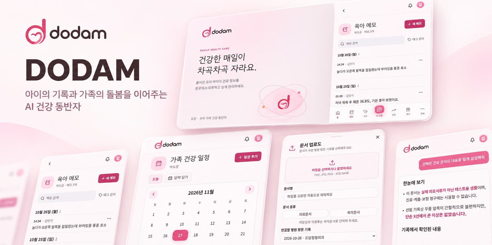
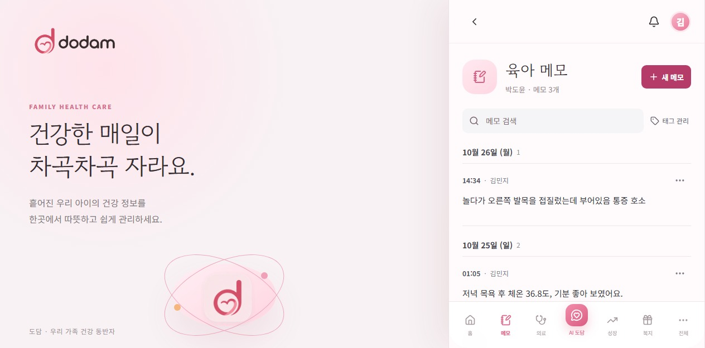
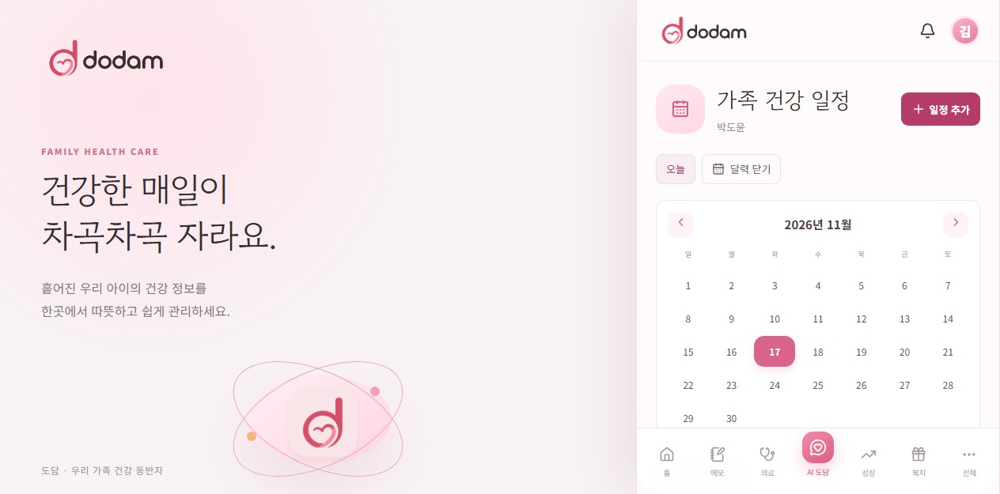
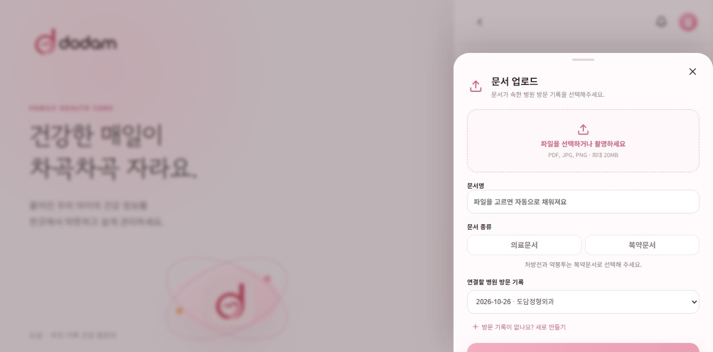
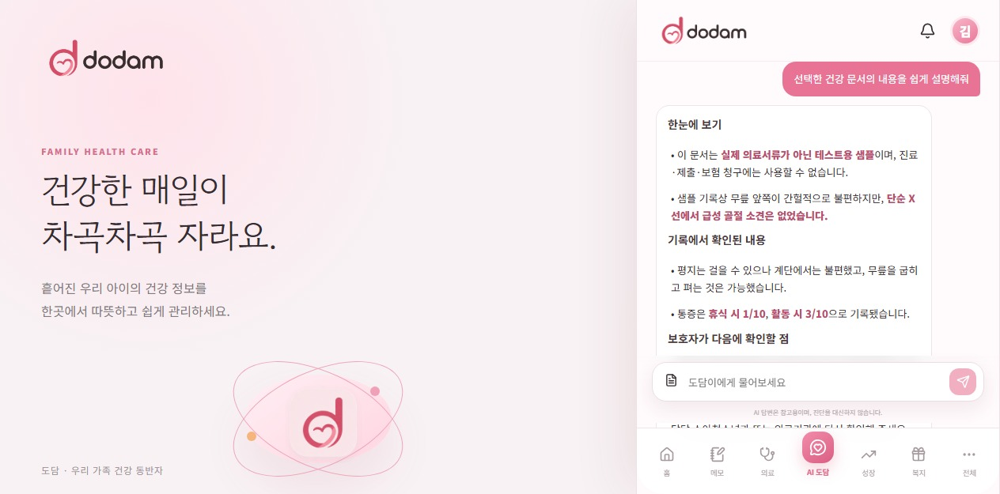
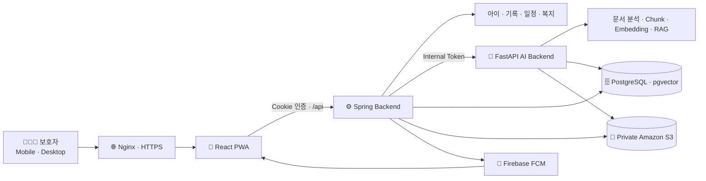
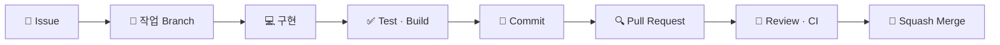

<div align="center">



# Team IEUM · 도담 DODAM

### 아이의 기록과 가족의 돌봄을 이어주는 AI 건강 동반자

[](https://dodam-ieum.duckdns.org/)
[](https://github.com/ieum-connect/Dodam_frontend)
[](https://github.com/ieum-connect/Dodam_backend)
[](https://github.com/ieum-connect/Dodam_AI_backend)
[](https://github.com/ieum-connect/Dodam_infra)

**흩어진 아이의 건강 기록을 한곳에 모으고, 어려운 의료 정보를 가족이 이해하고 함께 돌볼 수 있도록 연결합니다.**

</div>

---

## 👨‍👩‍👧‍👦 Team IEUM

<table align="center">
  <tr>
    <td align="center" width="33%">
      <a href="https://github.com/yendlessse">
        <br />
        <b>유한세</b>
      </a><br />
      <sub>@yendlessse · Developer</sub>
    </td>
    <td align="center" width="33%">
      <a href="https://github.com/MadVedi">
        <br />
        <b>정재헌</b>
      </a><br />
      <sub>@MadVedi · Developer</sub>
    </td>
    <td align="center" width="33%">
      <a href="https://github.com/choihwanwoo">
        <br />
        <b>최환우</b>
      </a><br />
      <sub>@choihwanwoo · Developer</sub>
    </td>
  </tr>
</table>

---

## 💗 도담은 어떤 서비스인가요?

도담은 영유아와 어린이의 **의료 문서·병원 방문·육아 메모·일정·성장 기록**을 아이별로 연결하고, 보호자가 어려운 의료 정보를 쉽게 이해할 수 있도록 돕는 가족 건강 관리 서비스입니다.

> AI는 진단을 대신하지 않습니다. 도담은 사용자가 선택하고 접근 권한이 확인된 건강 문서만 근거로 설명하며, 원문 Citation과 안전 안내를 함께 제공합니다.

| 기능 | 설명 |
|---|---|
| 👶 아이·가족 관리 | 아이 Profile, 보호자 관계와 가족별 접근 권한을 관리합니다. |
| 📝 육아 메모 | 증상·발달·일상 기록을 날짜와 Tag로 남기고 검색합니다. |
| 🏥 병원 방문 기록 | 진료 내용, 병원, 다음 방문과 연결 문서를 한 흐름으로 보관합니다. |
| 📅 건강 일정·복약 | 직접 일정과 반복 복약을 등록하고 완료·수정·알림을 관리합니다. |
| 📄 건강 문서 | PDF·JPG·PNG 문서를 방문 기록과 연결하고 AI 분석 상태를 확인합니다. |
| 🤖 문서 기반 AI 채팅 | 선택한 건강 문서의 근거 안에서 쉬운 설명과 다음 질문을 제공합니다. |
| 📈 성장·예방접종 | 키·몸무게 변화와 아이별 예방접종 일정을 확인합니다. |
| 🎁 맞춤 복지 | 가족 Profile과 지역 조건에 맞는 복지 제도와 추천 이유를 안내합니다. |
| 🔔 알림·PWA | 일정 알림과 Firebase Push를 제공하며 모바일 홈 화면에 설치할 수 있습니다. |

<details open>
<summary><b>🖼️ 도담 주요 화면 보기</b></summary>

<br />

<table>
  <tr>
    <td align="center"><b>육아 메모</b><br /></td>
    <td align="center"><b>가족 건강 일정</b><br /></td>
  </tr>
  <tr>
    <td align="center"><b>건강 문서 업로드</b><br /></td>
    <td align="center"><b>문서 기반 AI 채팅</b><br /></td>
  </tr>
</table>

</details>

---

## 🛠️ 기술 스택

### 🎨 Frontend


### ⚙️ Spring Backend


### 🤖 AI Backend


### ☁️ Infrastructure


---

## 🧭 서비스 아키텍처



1. Frontend는 Spring Backend만 호출합니다.
2. Spring Backend가 사용자 인증과 아이 접근 권한을 확인합니다.
3. 문서 분석·RAG·AI 채팅이 필요할 때만 내부 Token으로 AI Backend를 호출합니다.
4. 원본 건강 문서는 Private S3에 보관하고 관계형 데이터와 Embedding은 PostgreSQL·pgvector에 저장합니다.
5. 외부에는 Nginx의 HTTPS만 공개하며 Backend·AI·Database는 내부 Docker Network에서 통신합니다.

---

## 🗂️ Repository 구성

| Repository | 주요 책임 | 기술·실행 위치 |
|---|---|---|
| [Dodam_frontend](https://github.com/ieum-connect/Dodam_frontend) | 화면, 입력, 반응형 UI, PWA, Push 수신 | React · Vite · Nginx |
| [Dodam_backend](https://github.com/ieum-connect/Dodam_backend) | 인증·권한, 핵심 Domain, 문서·AI 중계, 일정·알림 | Java · Spring Boot |
| [Dodam_AI_backend](https://github.com/ieum-connect/Dodam_AI_backend) | 의료 문서 분석, Embedding, RAG, Citation 답변과 안전 정책 | Python · FastAPI |
| [Dodam_infra](https://github.com/ieum-connect/Dodam_infra) | Docker Compose, Nginx, AWS 배포, Backup과 운영 문서 | AWS · Docker · GitHub Actions |
| [.github](https://github.com/ieum-connect/.github) | 조직 Profile README와 공통 프로젝트 소개 | GitHub Organization Profile |

<details open>
<summary><b>📂 저장소별 내부 구조 자세히 보기</b></summary>

```text
ieum-connect/
├── Dodam_frontend/
│   ├── src/                       # React 화면, API Client, Domain UI
│   ├── public/                    # PWA Manifest, Service Worker, 아이콘
│   ├── docs/                      # 화면 캡처와 기능 검증 문서
│   └── .github/workflows/         # Frontend Build CI
│
├── Dodam_backend/
│   ├── src/main/java/.../         # 인증, 사용자, 아이, 기록, 일정, 문서, 복지
│   ├── src/main/resources/        # Application 설정과 Flyway Migration
│   ├── src/test/                  # Unit · Integration · Security Test
│   └── docs/convention/           # Branch · Commit · PR 공통 규칙
│
├── Dodam_AI_backend/
│   ├── app/api/                   # FastAPI Internal Router
│   ├── app/application/           # 분석·검색·설명 Use Case
│   ├── app/domain/                # 의료 안전, RAG, 예방접종 Domain
│   ├── app/infrastructure/        # Model, DB, Storage Provider
│   ├── prompts/                   # 문서 추출·설명 Prompt
│   └── tests/                     # Pipeline · Safety · RAG Test
│
├── Dodam_infra/
│   ├── docker/ · nginx/           # 운영 Image와 HTTPS Proxy
│   ├── postgres/                  # PostgreSQL · pgvector 초기화
│   ├── scripts/                   # 배포·Backup·상태 확인 Script
│   └── compose.production.yml     # 운영 Container 구성
│
└── .github/profile/
    ├── README.md                  # 조직 첫 화면
    └── assets/                    # 배너와 서비스 화면
```

</details>

---

## 🤝 개발 컨벤션

모든 저장소는 같은 Issue → Branch → Commit → Pull Request → Review → Squash Merge 흐름을 사용합니다.



<details open>
<summary><b>🌿 Branch · Commit · Pull Request 규칙</b></summary>

```text
Branch: <type>/<issue-number>-<short-kebab-case-description>
Commit: <type>(<scope>): <english subject>
PR:     <type>(<scope>): <한국어 변경 내용>
```

| Type | 사용 시점 |
|---|---|
| `feat` | 사용자 기능·Domain·Pipeline 추가 |
| `fix` | Bug·회귀·보안·안전 정책 수정 |
| `refactor` | 동작 변화 없는 구조 개선 |
| `docs` | README·명세·문서 변경 |
| `test` | Test·Fixture·Evaluation 추가 |
| `chore` | 설정·의존성·Data 정리 |

- 최신 `develop`에서 작업 Branch를 생성하고 한 Branch에는 하나의 Issue만 담습니다.
- `main`과 `develop`에는 직접 Push하지 않습니다.
- PR 대상은 원칙적으로 `develop`이며 CI 통과와 1명 이상 Approve가 필요합니다.
- API·DB·Migration·환경 변수·다른 저장소 영향과 실행한 Test를 PR 본문에 기록합니다.
- Merge는 **Squash and merge**를 사용하고 작업 Branch를 삭제합니다.

</details>

<details>
<summary><b>🧩 Issue · PR Template</b></summary>

| 문서 | 바로가기 |
|---|---|
| 기능 Issue Template | [열기](https://github.com/ieum-connect/Dodam_backend/blob/develop/.github/ISSUE_TEMPLATE/%EA%B8%B0%EB%8A%A5-%EC%9D%B4%EC%8A%88-%ED%85%9C%ED%94%8C%EB%A6%BF.md) |
| Bug Issue Template | [열기](https://github.com/ieum-connect/Dodam_backend/blob/develop/.github/ISSUE_TEMPLATE/%EB%B2%84%EA%B7%B8-%EC%9D%B4%EC%8A%88-%ED%85%9C%ED%94%8C%EB%A6%BF.md) |
| Branch Convention | [열기](https://github.com/ieum-connect/Dodam_backend/blob/develop/docs/convention/BRANCH_CONVENTION.md) |
| Commit Convention | [열기](https://github.com/ieum-connect/Dodam_backend/blob/develop/docs/convention/COMMIT_CONVENTION.md) |
| Pull Request Convention | [열기](https://github.com/ieum-connect/Dodam_backend/blob/develop/docs/convention/PR_CONVENTION.md) |

</details>

---

<div align="center">

### 아이의 검진 결과를 읽고, 필요한 돌봄으로 💗

Made with care by **Team IEUM**

</div>
